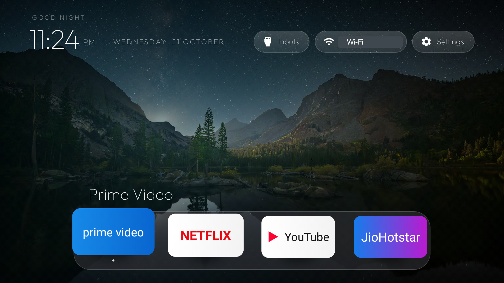

# Clean your Fire TV

[](https://github.com/theludiclabs/clean-your-fire-tv/actions/workflows/android.yml)
[](LICENSE)

A small, native launcher that gives compatible Fire TV devices a calmer home screen: large app artwork, a dock, scenic wallpapers, and an app grid. It is inspired by Apple TV's clean presentation, while remaining an independent project.



*Recent on-device screenshot. The Wi-Fi name is masked. App artwork is read from installed apps at runtime.*

## What you get

- **A quieter home screen:** Clean Home replaces the promotional layout while it is open.
- **Large app artwork:** The launcher uses artwork supplied by installed apps, with an app icon fallback.
- **A personal dock:** Pin, remove, and reorder apps with the remote.
- **A scenic backdrop:** Four coordinated mountain and lake wallpapers for morning, afternoon, evening, and night, plus a black option and a dynamic picker.
- **TV-friendly controls:** D-pad navigation, app grid, and shortcuts for Inputs, Wi-Fi, and Settings where Fire OS exposes them.
- **A lightweight interface:** Static images, no video playback, no blur effects, and no background network polling.
- **Reversible cleanup:** Where Fire OS permits package disabling, reviewed apps can be disabled without uninstalling system packages and re-enabled later.

## Important: Fire TV still runs Fire OS

This project installs a **launcher app**. It does not replace, remove, or unlock Fire OS, and it does not root the TV. Amazon controls whether a third-party launcher can become the Home-button destination and which packages can be disabled.

On the Fire TV Stick tested for this project (AFTT, Fire OS 5.2.8.4), Fire OS rejected attempts to disable manufacturer packages, and the remote's Home button continued to open Amazon Home. Clean Home can still be opened from **Your Apps & Channels** or with the included ADB helper. Other models and software versions may behave differently.

No package is uninstalled by this project. Do not disable streaming apps or services you use, voice control, casting, or system updates unless you have reviewed the package and chosen to keep that feature unavailable. Back up your device state first.

### Open Clean Home again

If the Home button returns to Amazon Home, open **Your Apps & Channels → Clean Home**. Or connect over ADB and run:

```bash
./open-clean-home.sh TV_IP
```

If a future Fire OS version exposes a **Default Home app** setting or a Home-app chooser, select Clean Home there. That option is absent on the tested Fire OS 5 build.

## Install

### Requirements

- A Fire TV on the same network as your computer
- ADB debugging enabled in **Settings → My Fire TV → Developer Options** (on newer models, enable Developer Options by selecting the device name in **About** several times)
- Android Platform Tools (`adb`) and Java 17 available in your terminal
- Android SDK Platform 34 and Build Tools; the Gradle wrapper downloads its pinned Gradle version and dependencies

### Steps

1. Find the TV's IP in **Settings → My Fire TV → About → Network**.
2. Clone this repository and open a terminal in the project folder.
3. Build the debug APK, install it, and open Clean Home:

   ```bash
   git clone https://github.com/theludiclabs/clean-your-fire-tv.git
   cd clean-your-fire-tv
   ./build-and-install.sh TV_IP
   ```

   For example: `./build-and-install.sh 192.168.1.42`
4. Accept the **Allow USB debugging?** prompt on the TV when it appears.
5. Open Clean Home from **Your Apps & Channels** if Fire OS returns to Amazon Home.

The Android build is only the native launcher APK. GitHub Actions compiles it and makes a debug APK available as a workflow artifact; it does not build a replacement Fire OS image.

### Connection troubleshooting

If ADB reports `No route to host` on macOS even though the TV is reachable, check macOS **System Settings → Privacy & Security → Local Network** and allow the terminal app to access the network. If macOS Local Network privacy blocks the stock ADB connection, the [Python `adb-shell` package](https://github.com/JeffLIrion/adb_shell) can be used as an alternative ADB client. This project's install script uses the `adb` command line tool and does not set up that alternative automatically.

## Customize

- **Dock:** Focus an app and press Menu or hold OK to pin/unpin it or move it left/right. The default app list is in `launcher/app/src/main/res/values/config.xml`.
- **Wallpaper:** Focus Settings and press Menu or hold OK. Choose Dynamic, Black, Morning, Afternoon, Evening, or Night. Dynamic selects from the four included scenic wallpapers based on the TV clock.
- **Your own wallpaper:** Replace the corresponding `bg_*.jpg` images in `launcher/app/src/main/res/drawable-nodpi/`, preserving filenames, then rebuild. Wallpaper sources and terms are in [CREDITS.md](CREDITS.md).
- **Re-enable a package:** If you disabled a package yourself, run `adb -s TV_IP:5555 shell pm enable --user 0 PACKAGE_NAME`.

## Repository guide

| Path | Purpose |
| --- | --- |
| `launcher/` | Native Android TV launcher source and Gradle build |
| `build-and-install.sh` | Build, connect, install, and open the launcher |
| `open-clean-home.sh` | Reopen Clean Home over ADB |
| `uninstall.sh` | Remove the launcher app (does not restore disabled packages) |
| `screenshots/` | Public, privacy-masked on-device screenshot |
| `CREDITS.md` | Wallpaper and other asset attributions |
| `PROMPT.md` | Reusable, safety-first checklist for an assistant-guided setup |
| `.github/workflows/android.yml` | Builds the debug APK on pushes and pull requests |

## Artwork and licensing

The launcher reads the banner or icon offered by each app installed on the TV. This keeps the artwork matched to the installed app without bundling third-party logos. An Apple TV app icon appears only if a compatible app is installed and pinned.

For additional artwork, use official assets supplied by the app publisher or artwork already provided by the installed TV app. The launcher source is MIT licensed; bundled images and fonts keep their own terms, listed in [CREDITS.md](CREDITS.md), [FONT-LICENSE-OFL.txt](FONT-LICENSE-OFL.txt), and the notices in `launcher/`.

## License

Source code: [MIT](LICENSE). Brand and service names belong to their respective owners. This independent project is not affiliated with Amazon or Apple.
